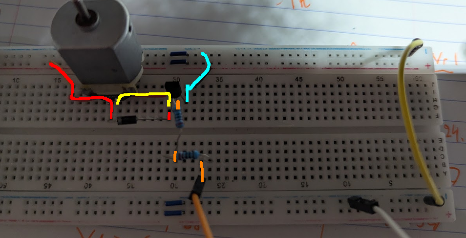

# Exercices - Moteurs et gestion des FCEM

Nous allons vouloir faire un circuit allumant automatiquement un ventilateur lorsqu'il fait trop chaud. 

Dans cet objectif, nous allons utiliser un thermistor - une résistance qui varie selon la température - afin de contrôller l'intensité de rotation du moteur.
## Exercice 1

La première étape consiste à se faire un circuit permettant de mesurer la température ambiante. À cet effet, nous allons utiliser une résistance dont la valeur change avec la température (un thermistor).

Comme avec la photorésistance, nous allons vouloir commencer en faisant un circuit nous permettant de voir comment la résistance de notre thermistor change selon la température. 

Branchez le thermistor en série avec une DEL. 

Tenez le thermistor entre vos doigt afin de le réchauffer. Normalement, la DEL devrait devenir plus lumineuse. 

**Question :** Comment peut-on décrire le changement de résistance selon le changement de température ambiante?

## Exercice 2

Nous allons ensuite connecter un diviseur de tension composé de notre thermistor à l'une des broches de notre ESP32. 

Nous allons vouloir utiliser le ESP32 pour allumer une DEL bleue lorsqu'il fait trop chaud.

### Exercice 3 - Moteur contrôlé par transistor

>[!danger] Cet exercice introduit des éléments présentants des **risques** pour votre ESP32. Il est important de faire très attention aux éléments suivants sous risque d'endommager ou briser votre matériel : 
> - Ne **jamais** faire et défaire des branchements pendant que vos équipements sont alimentés.
> - Assurez-vous de respecter à la lettre les schémas fournis.
> - Assurez-vous que les branchements en séries sont réellement en séries.
> - Ne connectez **jamais** votre moteur directement à votre ESP32.

>[!danger] Cet exercice va combiner 2 sources d'alimentation distinctes : l'alimentation 5V USB et l'alimentation 5V provenant de votre bloc d'alimentation. **Vous allez devoir connecter le GND du ESP au GND du power supply**.

Nous allons remplacer la DEL bleue par un moteur qui s'allume lorsqu'il fait chaud. Dans un monde idéal, notre moteur aurait des hélices qui pousseraient de l'air.

**Vous allez avoir besoin du matériel suivant :** 
- 2 résistance 220Ω
- Une diode 1N4001
- Un moteur DC 5V
- Un transistor NPN 8050 (ou équivalent)
- Un bloc d'alimentation avec batterie 9V
 
**Le bloc d'alimentation :** 

**La diode 1N4001 :** 

**Schéma du circuit :** 

**Le circuit complété :**

**Avec couleur :** 

**Précision sur le circuit :**
- Les rails d'alimentation du haut sont alimentés par le bloc d'alimentation.
- Sur les rails du bas : uniquement le GND est connecté
- Le GND du ESP32 (le fil blanc) est connecté au GND du bloc d'alimentation (via le fil jaune)

### Diode flyback (i.e. explication sur la diode weird)

Un moteur électrique en actuation va toujour générer une charge électrique en opposition à celle qui l'active. Lorsque nous coupons l'alimentation du moteur, cette charge va pousser temporairement dans le sens contraire. Notre moteur va donc temporairement se comporter comme un générateur. 

On appel cette charge _back EMF_ ou _force contre-électromotive_ (FCEM) en français.

**Cette charge électrique doit être gérée. Toujours.** 

Si on ne la gère pas : 
- Cette charge pourrait endomager le transistor.
- Si la tension générée par le moteur est suffisament élevée, elle pourait même passer à travers le transistor et bruler le ESP32
- Elle pourrait aussi créer du bruit électrique dans le reste du circuit et endomager d'autres composants.

La diode 1N4001 est ce qu'on appel une diode de flyback. C'est un diode qui peut transporter un courant élevé sans risque pour sa santé. 

En opération normale : elle est placée à l'envers et ne va rien faire.

Lorsque l'on éteint l'alimentation du moteur, elle va fourir un chemin de retour entre les broches de notre moteur qui va ainsi permettre de dissiper la charge générée.

>[!attention] Dès qu'il est question de moteur ou de _coil_, il faut penser à gérer les charges inductives. L'utilisation d'une diode de flyback est l'un des moyens les plus simples.

### Exercice 4 - Moteur contrôlé par un relais

>[!attention] Cet exercice est beaucoup plus complexe que le précédent. Il est aussi considéré comme optionel.

En réalité le moteur peut demander un courant qui dépasse ce que votre transistor peut fournir. C'est d'autant plus vrai si l'on commence à mettre de la résistance sur la tige rotative du moteur. Plusieurs modèles de BJT pourraient supporter notre moteur ou on pourrait aussi utiliser transistor de type MOSFET.

On va utiliser un autre composant : le relais.

#### Le relais

Un relais est un interrupteur contrôlé électriquement. Son fonctionnement est électromécanique : un électroaimant contrôle la position de l'interrupteur.

Les broches A1 et A2 permettent d'alimenter un électroaimant. Lorsqu'un courant les traverse, l'électroaimant s'active et la change laquelle de 12 et 14 est connectée à 11.

Les deux broches 11 sont connectés entre elle. Le principe est le même que sur un bouton poussoir. Cette broche peut être connectée à l'une de 12 ou 14 :
- 12 est la broche dites "nominally closed" (NC). Cela signifie que le circuit entre 11 et 12 est fermé lorsqu'aucun courant ne traverse A1 et A2.
- 14 est la broche dites "nominally open" (NO). Cela signifie que le circuit entre 11 et 14 est ouvert lorsqu'aucun courant ne traverse A1 et A2.

Lorsqu'un courant traverse A1 et A2, le circuit entre 11 et 12 s'ouvre, et le circuit entre 11 et 14 se ferme.

Comme un transistor, un relais nous permet de contrôler l'actuation d'un interrupteur à l'aide d'une charge électrique.

**En différence d'un transistor :** 
- Le fonctionnement est mécanique.
- Le courant traversant A1 et A2 peut être entièrement disocié du courant traversant le 11 et 12/14.
- Un relais peut contrôler un courant et une tension beaucoup plus élevé. En fait, nos relais supportent un courant allant jusqu'à 3 ampères pour une tension de 30V DC (vs 500mA pour nos S8050)!

### Exercice 4.1 - Tester le HK4100F

Reproduisez le circuit suivant afin de tester les branchements avec le HK4100F : 

Appuyer sur le bouton devrait changer la DEL qui s'allume. Vous devriez entendre un [_clique_](https://youtu.be/zhl-Cs1-sG4?t=95) lorsque l'aimant s'active.

### Exercice 4.2 - Le vrai circuit. Vous êtes prêt?

**Le circuit de controle du moteur :** 

>[!danger] Le relais nous permet de traiter le circuit du ESP et le circuit du moteur comme deux circuits indépendants. **Il ne faut pas connecter les GND ensemble.**

**Le circuit complété :** 

**Précisions sur le circuit complété :** 
- Le bloc d'alimentation fournit du courant à un rail d'alimentation seulement (sur la photo : celui du haut).
- Le ESP32 fournit 5V sur le second rail d'alimentation (les deux fils blancs). Ce rail n'est utilisé que pour le coil du relais. 
- Les GND du bloc d'alimentation et du ESP32 ne sont pas reliés. Ces deux alimentations sont entièrement indépendantes. 
- Le ESP32 contrôle la base du transistor via un GPIO. Le signal provient du fil orange et traverse les deux résistances de 220 ohm en série.
- La diode de flyback est directement au dessus du relais - c'était plus compact comme ça.
- On voit mal le snubber RC sur cette photo.
- Mon moteur est déffectueux. J'ai donc ajouté une DEL en parallèle (la DEL verte) au moteur pour mieux visualiser le comportement du relais. 

**On voit mieux le snubber RC sur cette photo :** 

**Vidéo du circuit:**

[Liens si le vidéo n'apparait pas directement](./video/relais.mp4)

<video controls width="800">
	<source src="video/relais.mp4">
</video>

#### Relais et diode de flyback

Le coil du relais doit être accompagné aussi d'un mécanisme pour gérer la charge inverse.

#### Snubber RC

Remarquez le petit circuit en parallèle avec le moteur : 

Cet agencement de résistance et de capaciteur est appelé un **snubber RC**. Il joue un rôle similaire à la diode de flyback. 

Normalement, les valeurs pour la résistance et le capaciteur sont choisis empiriquement selon le modèle de moteur. Dans notre cas, comme on a peu de matériel disponible, on va y aller avec notre plus petite résistance et notre plus petit capaciteur.

Utilisez un de vos petits capaciteurs en céramique : 

