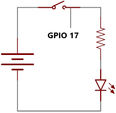
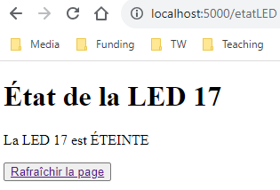
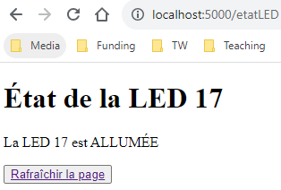
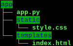
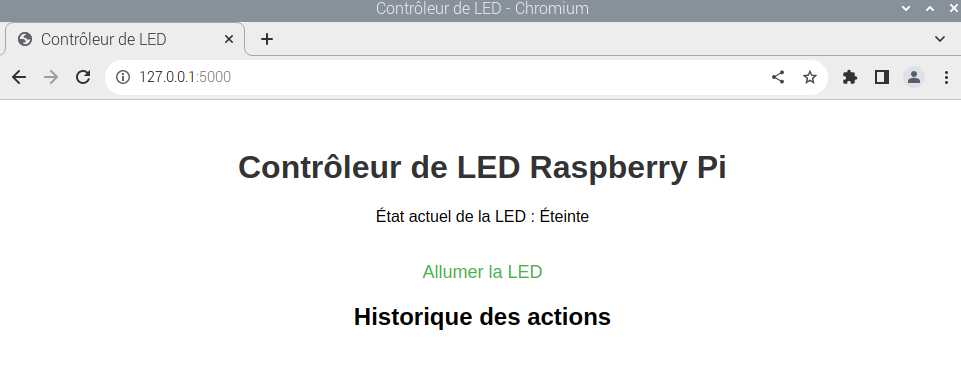
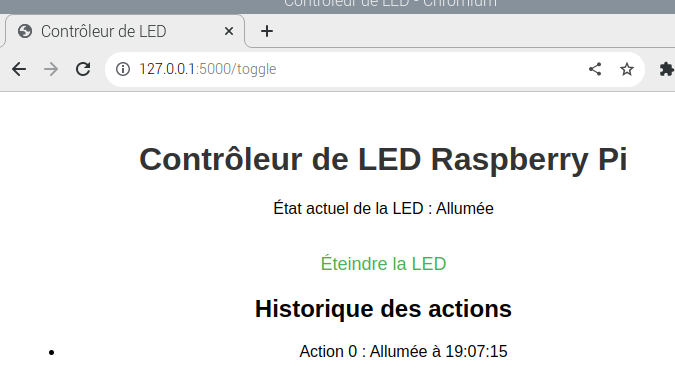
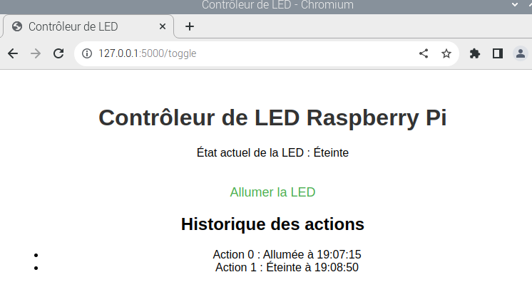
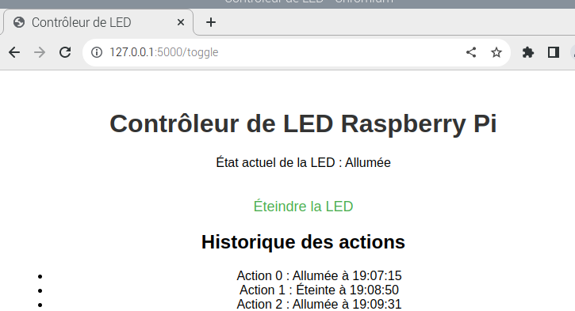
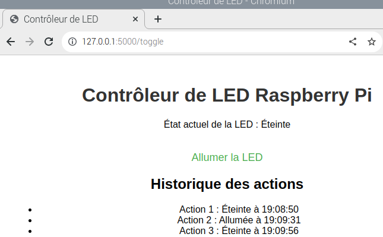
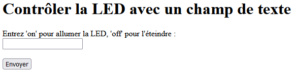

# Exercices - Flask

## Exercice 1

Soit le circuit suivant :



Créez une page web qui sera hébergée localement sur un serveur web Flask. Une fois le serveur démarré :

```bash
python app.py
```

Votre page web donnera l’état courant de LED 17, soit l’un des deux cas suivants :





## Exercice 2 : contrôle d’une LED avec une page web

Sur votre Raspberry Pi, créez la structure de fichiers suivantes :



Le fichier app.py contiendra la logique de votre programme, index.html sera la seule page web de votre panneau de contrôle et style.css permettra de styliser votre page, par exemple pour la couleur. Sur votre Raspberry Pi, faites les branchements nécessaires pour une seule LED.

Au départ, votre page web aura cette allure :



Chaque clic sur le lien « Allumer la LED » ou « Éteindre la LED » aura pour conséquence d’allumer ou d’éteindre la LED sur votre platine et de conserver l’action dans un historique (vide au départ).  

Seules les trois dernières actions seront montrées dans l’historique. Voici quelques exemples : 









## Exercice 3 - Flask et les formulaires

Écrire une application Flask qui utilise un formulaire pour contrôler une LED à partir du texte saisi dans un champ de texte de la manière suivante :

Tout autre saisie que « on » ou « off » n’aura aucune conséquence.

